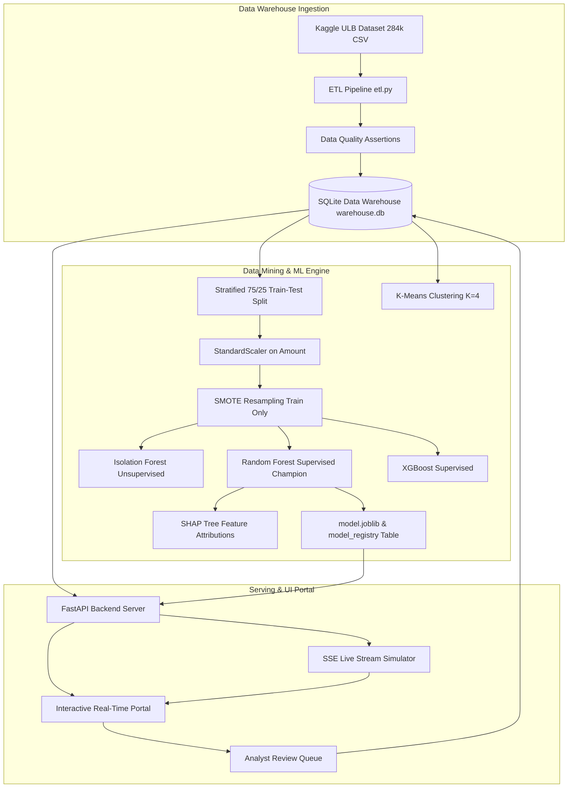

# Credit Card Fraud Detection – Real-Time Analytics Portal

[](https://www.python.org/)
[](https://fastapi.tiangolo.com/)
[](https://www.sqlite.org/)
[](LICENSE)

An enterprise-grade credit card fraud analytics web application and portal built for Data Mining and Data Warehousing (DMDW). It combines dimensional star-schema warehousing, automated ETL, comparative machine learning (Isolation Forest, Random Forest, XGBoost with SMOTE), real-time transaction streaming via Server-Sent Events (SSE), SHAP explainability, and an analyst review queue.

---

## 🚀 How to Run the Website

No Docker required. The portal runs natively on your machine with Python:

### Step 1: Install Dependencies (if not already installed)
```bash
pip install -r requirements.txt
```

### Step 2: Launch the Website
Simply double-click **`start_website.bat`** (on Windows) or execute:
```bash
python app.py
```

The portal will launch and open automatically in your browser:
- 👉 **Web Portal:** [http://localhost:8000](http://localhost:8000)
- 👉 **API Documentation (Swagger):** [http://localhost:8000/docs](http://localhost:8000/docs)

---

## 🏛️ System Architecture



---

## 🧭 The 4 Core Website Sections

1. **⚡ 1. Real-Time Live Tracking (Default View)**:
   - Auto-starts streaming transactions live via Server-Sent Events (SSE) at customizable speeds (0.5s, 1.0s, 2.0s).
   - Real-time rolling fraud risk chart tracking transaction risk probability.
   - Dual live feeds: **High-Risk Alerts** (highlighting top SHAP contributing features) and **Live Activity Feed**.
   - Session KPIs: Live Transactions Processed, Fraud Count, Session Fraud Rate, and Prevented Dollar Loss.

2. **📊 2. Portfolio Overview & KPIs**:
   - Warehouse KPIs: Total transactions (283,726), confirmed fraud count (473), fraud rate (0.167%), and total dollars at risk ($58,591).
   - Temporal distributions: Fraud by time of day (Night, Morning, Afternoon, Evening) and 48-hour transaction trends.
   - ETL Audit log displaying pipeline run status, duration, and row counts.

3. **🎯 3. Screen a Transaction**:
   - Interactive transaction scoring form with custom amount and PCA feature inputs.
   - One-click buttons to load real verified **Legitimate** or **Fraudulent** benchmark samples.
   - Real-time probability gauge, risk classification tag, and SHAP feature attribution bar chart explaining model decisions.

4. **📝 4. Analyst Review Queue**:
   - Triage table for flagged suspicious transactions.
   - Allows fraud investigators to submit final dispositions (**Confirm Fraud** or **False Alarm**) with audit notes persisted in the database.

---

## 🧪 Running Automated Tests

Run the test suite with:
```bash
python -m pytest tests/ -v
```
Verifies data quality assertions, foreign keys, model scoring, SHAP attributions, and API endpoints.
