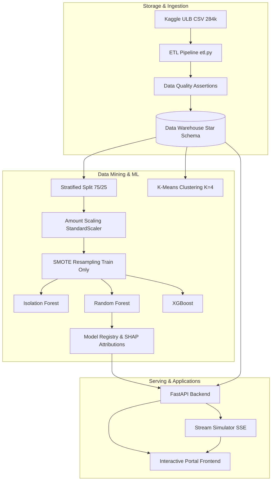

# Credit Card Fraud Detection Portal – Project Report Notes
**Course:** Data Mining and Data Warehousing (DMDW)  
**System Name:** Credit Card Fraud Detection Portal  
**Dataset:** Kaggle ULB Credit Card Fraud Detection (284,807 transactions)

---

## 1. Problem Statement
Credit card fraud represents billions in global financial losses annually. Designing an automated detection system presents severe challenges:
1. **Extreme Class Imbalance:** In the Kaggle ULB benchmark dataset, only 492 out of 284,807 transactions are fraudulent (0.173%). A naive baseline model that classifies 100% of transactions as legitimate achieves **99.827% accuracy**, yet fails to detect a single fraud incident ($0 caught). Accuracy is therefore actively misleading.
2. **Asymmetric Business Costs:** A missed fraudulent transaction (False Negative) causes direct financial chargeback loss (e.g., \$500+), whereas an incorrect flag on a legitimate customer (False Positive) incurs a small analyst review cost (e.g., \$10) or customer friction.
3. **Data Warehousing & OLAP Requirements:** Operational fraud investigators require multi-dimensional slice-and-dice queries across merchants, card types, time periods, and transaction bands to identify emerging attack patterns.

---

## 2. System Architecture

---

## 3. Data Warehouse Star Schema Design Rationale

### Star Schema Architecture
A star schema was selected over a normalized 3NF snowflake schema to optimize OLAP aggregation speeds:
- **`fact_transaction`**: Central grain at individual transaction level. Contains `txn_id`, dimension foreign keys (`time_key`, `band_key`, `merchant_key`, `card_key`), numeric `amount`, ground truth `is_fraud`, 28 anonymized PCA components `V1`..`V28`, and inference audit fields (`predicted_probability`, `ingested_at`).
- **`dim_time`**: Conformed dimension containing 48 hours mapped into `day` (1-2), `hour` (0-23), and `period` (Night: 0-5h, Morning: 6-11h, Afternoon: 12-17h, Evening: 18-23h). Enables hierarchical roll-up and drill-down.
- **`dim_amount_band`**: 5 discrete financial bands (`Micro <$10`, `Low $10-$50`, `Medium $50-$200`, `High $200-$1,000`, `Jumbo $1,000+`).
- **`dim_merchant` (SIMULATED)**: 8 merchant categories (`Grocery`, `Electronics`, `Travel`, `Restaurants`, `Fashion`, `Online Services`, `Fuel`, `Healthcare`) with associated risk tiers.
- **`dim_card` (SIMULATED)**: 5 payment instrument combinations (`Visa Debit`, `Visa Credit`, `Mastercard Debit`, `Mastercard Credit`, `RuPay`).

### Performance Optimizations
1. **Foreign Key Indexes:** Dedicated B-Tree indexes on `time_key`, `band_key`, `merchant_key`, `card_key`, and composite `(is_fraud, time_key)`.
2. **Dual-Database Portability:** Configurable via `.env` to run natively in SQLite (`warehouse.db`) for lightweight local development or in PostgreSQL container for enterprise deployments.

---

## 4. ETL Pipeline Description

The ETL pipeline (`etl/etl.py` and `etl/airflow_dag.py`) performs:
1. **Extract:** Loads 284,807 raw records from `data/creditcard.csv`.
2. **Transform:**
   - Drops 1,081 duplicate rows (retaining 283,726 unique rows).
   - Verifies zero null values.
   - Derives `time_key` as `floor(Time / 3600)`.
   - Buckets amounts into 5 bands.
   - Generates simulated merchant and card dimensions using a fixed random seed (`seed=42`) for reproducibility.
3. **Data Quality Verification:**
   - Row conservation check: `len(fact) == rows_extracted - rows_rejected`.
   - Foreign key referential integrity: ensures zero orphan foreign keys.
   - Fraud ratio sanity bounds: asserts fraud prevalence is strictly between 0.05% and 1.0%.
   - Non-negative financial amounts check.
4. **Idempotent Load:**
   - Bulk-inserts dimensions and facts with `chunksize=25000`.
   - Records execution audit metadata (`run_timestamp`, `rows_extracted`, `rows_loaded`, `rows_rejected`, `fraud_rows`, `duration_seconds`, `data_quality_passed`, `notes`) into `etl_run_log`.

---

## 5. Machine Learning Experimental Results

### Dataset Partitioning & Preprocessing
- **Stratified Split:** 75% Training (212,794 txns, 355 frauds) / 25% Testing (70,932 txns, 118 frauds).
- **Feature Scaling:** `StandardScaler` applied strictly to `amount` (fitted exclusively on the training partition to prevent data leakage).
- **Class Balancing:** `SMOTE` with `sampling_strategy=0.2` applied only to training data, expanding minority fraud cases to 42,487.

### Actual Experimental Benchmark Metrics (Test Set: N = 70,932)

| Model Name | Precision | Recall | F1-Score | PR-AUC | ROC-AUC | TP (Caught) | FP (False Alarm) | FN (Missed) | TN (Legit) | Fit Time |
| :--- | :---: | :---: | :---: | :---: | :---: | :---: | :---: | :---: | :---: | :---: |
| **Isolation Forest** (Unsupervised) | 15.18% | 14.41% | 0.1478 | 0.0827 | 0.9448 | 17 | 95 | 101 | 70,719 | 4.31s |
| **Random Forest** (Supervised + SMOTE) ⭐ | **88.35%** | **77.12%** | **0.8235** | **0.8219** | **0.9788** | **91** | **12** | **27** | **70,802** | 134.61s |
| **XGBoost** (Supervised + SMOTE) | 61.69% | 80.51% | 0.6985 | 0.7816 | 0.9802 | 95 | 59 | 23 | 70,755 | 11.54s |

### Headline Metric Explanation
- Accuracy is excluded because predicting all zeros yields 99.83% accuracy with 0% recall.
- **Random Forest is selected as Deployed Champion** because it maximizes F1-Score (0.8235) and PR-AUC (0.8219), keeping false alarms to just 12 incidents out of 70,814 legitimate transactions while catching 91 frauds (77.12% recall).
- 5-Fold Stratified Cross-Validation on SMOTE data verified Random Forest generalization with **Mean F1 of 0.9714 ± 0.0057**.

### Decision-Threshold Tuning & Business Trade-Off Curve
By default, models classify at $P \ge 0.50$. In production, institutions choose operating thresholds based on cost:
- **Low Threshold (0.10):** Catches 85.59% of frauds (101 caught, 17 missed), but produces 26 false alarms ($10/review cost).
- **Standard Threshold (0.50):** 77.12% fraud caught (91 caught, 27 missed), 12 false alarms.
- **Conservative Threshold (0.80):** 69.49% fraud caught, only 4 false alarms (near-zero customer friction).

### Core Data Mining: K-Means Transaction Profiling
Beyond supervised classification, K-Means clustering ($K=4$) was executed on behavioral dimensions (`amount`, `time_key`, `V10`, `V12`, `V14`, `V17`):
- **Cluster 3 (High-Value Commercial Spending):** 22,556 txns, Fraud Rate: 0.554% (**Risk Index: 3.32x normal**).
- **Cluster 2 (Moderate Evening Commerce):** 4,160 txns, Fraud Rate: 0.312% (**Risk Index: 1.87x normal**).
- **Cluster 1 (High-Variance Profile):** 123,655 txns, Fraud Rate: 0.171% (1.03x normal).
- **Cluster 0 (Routine Daytime Micro-transactions):** 133,355 txns, Fraud Rate: 0.092% (**0.55x normal**).

---

## 6. Limitations

1. **Simulated Dimensions:** The Kaggle dataset anonymizes merchant identities and card types. While dimensions (`dim_merchant`, `dim_card`) are simulated with a fixed seed (`seed=42`), real-world deployments require merchant category codes (MCCs), device fingerprints, and geolocation coordinates.
2. **Anonymized PCA Features:** Features `V1`–`V28` are principal components. While SHAP attributions identify which components contribute most heavily to risk (primarily `V10`, `V14`, `V12`, `V11`), domain-specific interpretation is limited without original column mappings.
3. **Temporal Scope:** The dataset spans 48 hours (172,792 seconds). Seasonality, holiday surges, and day-of-week patterns cannot be evaluated without multi-month transaction logs.

---

## 7. Future Work
1. **Streaming Anomaly Detection:** Integrate Apache Kafka or AWS Kinesis to ingest high-throughput credit card transaction streams (>10,000 TPS).
2. **Concept Drift & Active Learning:** Implement an automated retraining pipeline that updates model weights when analyst reviews indicate new fraud vectors.
3. **Graph Neural Networks (GNNs):** Model cardholder-to-merchant bipartite graphs to detect fraud syndicates and synthetic identity rings.
